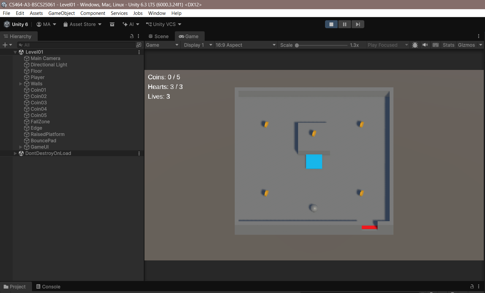
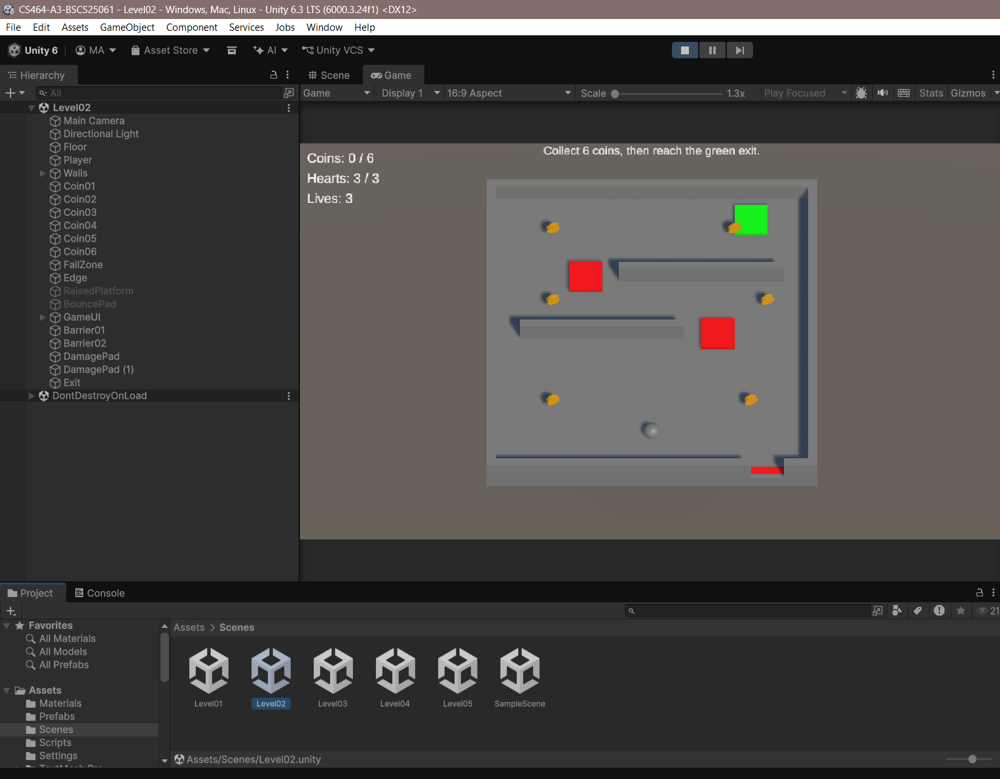
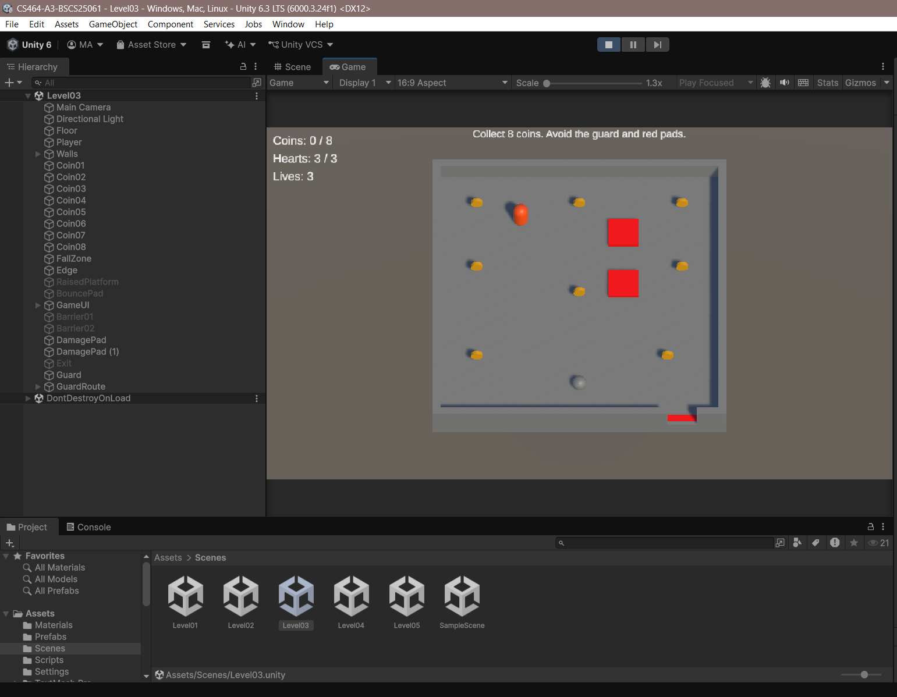
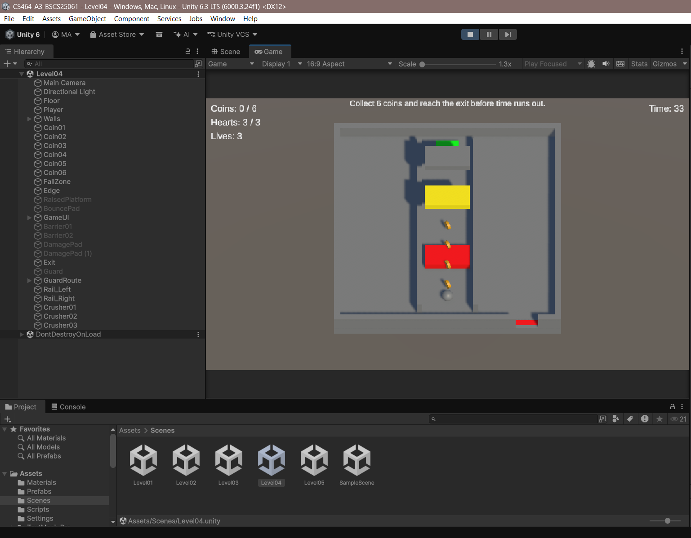
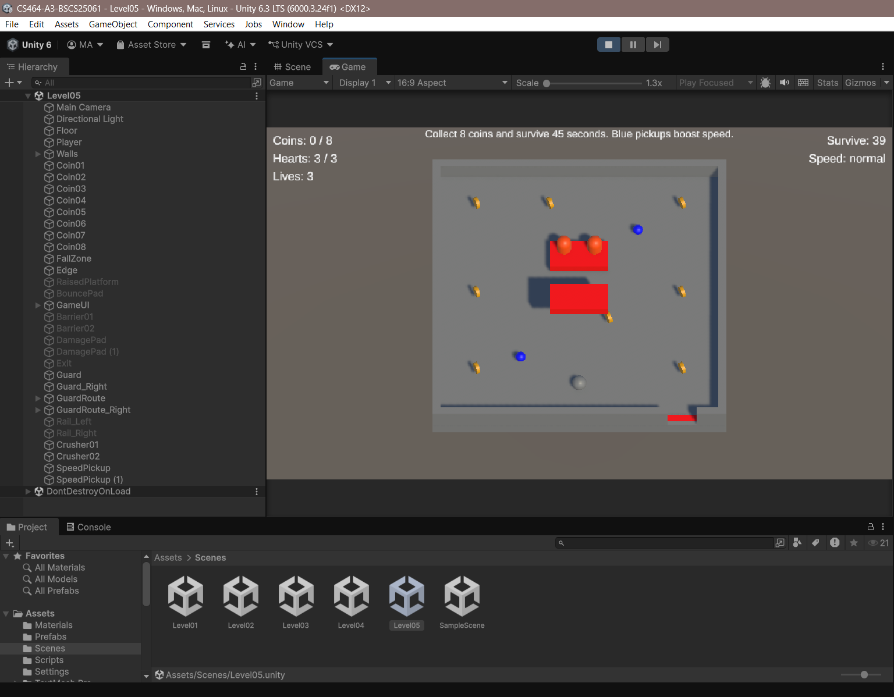

# CS464 Assignment 03 · Muhammad Abdullah Usman · BSCS25061

- **Video (60–120 s):** [Watch demonstration](https://drive.google.com/file/d/1IHGum9fa3U_Lea1pywpSp2XHB0PL9VSw/view?usp=sharing)
- **Started from:** [My Lab06 repository](https://github.com/Muhammad-Abdullah-Usman/ITU-CS-464-LAB-06-BSCS25061). These five levels were newly created for Lab06 and reused here following the instructor's group clarification.
- **Controls:** WASD or arrow keys to move; R to restart; buttons to restart or continue.
- **To win a level:** Level01: collect 5 coins. Level02: collect 6 coins and reach the exit. Level03: collect 8 coins. Level04: collect 6 coins and reach the exit within 35 seconds. Level05: collect 8 coins and survive 45 seconds.

## Levels

| Level | Screenshot | New idea | Combined with |
|---|---|---|---|
| Level01 |  | Coins and a bounce pad | A raised platform |
| Level02 |  | Damage pads and an exit goal | Coins and barriers |
| Level03 |  | A guard that patrols, chases and returns | Coins and damage pads |
| Level04 |  | Crushers with warnings and a countdown | Coins and an exit in a narrow corridor |
| Level05 |  | Timed speed pickups and survival | Coins, two guards and crushers |

## The numbers

| Number | Value | Why this value |
|---|---|---|
| Patrol speed | 2 m/s | Makes the patrol easy to observe before approaching the guard |
| Chase range | 4 m | Requires the player to get close before the guard starts chasing |
| Knockback | 8, ForceMode.Impulse | Gives a noticeable push away from the hazard after a hit |
| I-frames | 1 second | Gives the player time to move away without taking damage every physics step |
| Power-up duration | 6 seconds | Gives enough time to cross the arena and reach the second pickup |

## Short answers

**1. Why does a trigger need a Rigidbody on at least one of the two objects?**

Unity needs at least one Rigidbody in the pair for these trigger interactions.
My player has a Rigidbody, so the coins and stationary hazards only need
trigger colliders. Moving guards have their own kinematic Rigidbodies.

**2. Which ForceMode do your knockback and your Part A force use, and why each?**

Knockback uses ForceMode.Impulse because it applies a single push whose
effect depends on mass. The bounce pad uses ForceMode.VelocityChange
because it gives a single upward velocity change independent of mass.
Movement input pauses briefly after damage so it does not fight the knockback.

**3. What does your code do when a second power-up is picked up while one is running?**

It refreshes the boost to 6 seconds from the second pickup.
The multiplier stays at 1.5 instead of stacking.
The timer stays on the player, so destroying the pickup does not stop it.

**4. Why can == fail as an arrival check, and when does it work?**

Movement can pass a waypoint without getting inside the small tolerance
used by Vector3 equality. MoveTowards can reach the target exactly when
one step covers the remaining distance, so equality can work after that move.
My guard uses a distance check of less than 0.15 metres instead.